# Arquitetura e Decisões de Design — Flvxus v2

> Documento principal de arquitetura do **relançamento v2** do Flvxus — plataforma para
> personal trainers (professores) gerenciarem alunos: avaliação física, exercícios, treinos,
> dietas com IA e área do aluno.
>
> Este documento define o **plano** e os **contratos**. Ele **não** contém código de
> aplicação, migrations SQL nem componentes React — essas peças serão produzidas nas fases
> seguintes (ver §12). Toda a interface e documentação do produto é em **português do Brasil**.
>
> Baseia-se na auditoria (`docs/audit.md`) e **não contradiz** o ADR 0001
> (`docs/decisions/0001-ia-anthropic.md`). As decisões transversais estão registradas como
> ADRs individuais em `docs/decisions/` e referenciadas ao longo do texto.
>
> Data: 2026-10-19 · Fase 1 (Arquitetura v2)

---

## Índice

1. [Visão geral](#1-visão-geral)
2. [Stack final e versões](#2-stack-final-e-versões) — ADR 0002
3. [Estrutura de pastas v2](#3-estrutura-de-pastas-v2)
4. [Modelo de camadas e fluxo de dados](#4-modelo-de-camadas-e-fluxo-de-dados)
5. [Autenticação e autorização](#5-autenticação-e-autorização) — ADR 0004
6. [Modelo de dados v2 (ER)](#6-modelo-de-dados-v2) — ADR 0003
7. [Storage privado](#7-storage-privado) — ADR 0005
8. [Camada de IA (Edge Functions Anthropic)](#8-camada-de-ia-edge-functions-anthropic) — ADR 0001
9. [Design system e front-end](#9-design-system-e-front-end) — ADR 0006
10. [Mobile/Capacitor e PWA](#10-mobilecapacitor-e-pwa) — ADR 0007
11. [LGPD / privacidade](#11-lgpd--privacidade)
12. [Testes e CI](#12-testes-e-ci) — ADR 0008
13. [Plano de migração/sequenciamento](#13-plano-de-migração-e-sequenciamento)
14. [Lista de ADRs](#14-lista-de-adrs)

---

## 1. Visão geral

A v2 mantém o propósito e a stack-base da v1 — **Next.js (App Router) + Supabase +
Radix/shadcn + Tailwind + Capacitor** — mas **reescreve o banco de dados do zero**,
**troca a camada de IA de Google Gemini para Anthropic via Edge Functions** e **endurece a
segurança** (Storage privado, gate por papel, RLS testado). A auditoria concluiu que a base
tem valor como referência de funcionalidades e UX (226 componentes `.tsx`), mas que a dívida
de banco, IA e segurança justifica reconstruir essas camadas em vez de remendar.

O produto tem **dois perfis** sobre um modelo **multi-tenant** (um tenant por personal):

- **Professor (personal):** cadastra/gerencia alunos, faz avaliações físicas e posturais com
  histórico e gráficos, mantém biblioteca de exercícios, monta treinos (modelos reutilizáveis
  e fichas por aluno), gera dietas e sugestões com IA (sempre como rascunho a aprovar) e vê
  um painel de visão geral (ativos, aderência, avaliações vencidas).
- **Aluno:** vê treinos liberados, registra execução (cargas, reps, check de séries), vê
  dieta liberada, evolução e avaliações, numa experiência **mobile-first** para uso durante
  o treino.

Princípios de arquitetura que guiam todas as decisões abaixo:

1. **Segurança por padrão.** RLS em todas as tabelas, isolamento total entre tenants, Storage
   privado com URLs assinadas, segredos só no servidor. Dados de saúde são sensíveis (LGPD).
2. **Um único caminho confiável por operação.** Cada operação tem uma camada dona (Server
   Component, Server Action, Route Handler ou Edge Function) — nada de lógica duplicada entre
   client e server como na v1.
3. **Reprodutibilidade.** O banco se reconstrói de forma determinística a partir das
   migrations versionadas + `seed.sql`. Zero SQL manual.
4. **Contratos explícitos.** Enums nativos no banco, schemas Zod no limite da aplicação e na
   saída da IA, tipos TS gerados a partir do banco. A verdade mora em um só lugar.
5. **IA com guarda-corpos.** Toda chamada de IA passa por Edge Function autenticada, com
   validação Zod, rate limit, log de uso e fluxo rascunho→aprovação (ADR 0001).

---

## 2. Stack final e versões

> Decisão detalhada em **ADR 0002** (`docs/decisions/0002-stack-nextjs-supabase-ssr.md`).

### 2.1 Framework e runtime

**Next.js 15 (estável, App Router) com React 19.** A v1 está travada em
`14.2.0-canary.29` — uma versão canary, inadequada para produção — sobre React 18.2. Avaliei
duas opções:

- **Next 14.2.x estável + React 18.3.** Caminho mais conservador; mantém os 226 componentes
  praticamente intocados, mas não sai da linha 14 e exigiria migrar de novo em breve.
- **Next 15 estável + React 19.** Caminho recomendado. Ganha correções de longo prazo,
  melhorias de cache mais previsíveis (o cache deixa de ser agressivo por padrão em `fetch` e
  rotas) e alinhamento com o `@supabase/ssr`. O Next 15 estável fixa **React 19** como peer
  dependency (seu App Router foi lançado sobre o React 19); não é possível combinar Next 15
  com React 18.3. O par correto é **Next 15 + React 19**.

**Escolha: Next 15 estável com React 19.** O relançamento é o momento certo para sair da
canary e evitar a dívida de migrar de novo em poucos meses. O ponto de atenção do Next 15
(mudança de defaults de cache) é administrável e, na prática, torna o comportamento mais seguro
para um app com dados por usuário. O custo real da migração está na subida de React 18→19: os
componentes shadcn/Radix têm versões compatíveis com React 19, mas **alguns pacotes Radix podem
exigir bump de versão**, e esse é o custo a confirmar na Fase 3 (ver §2.3 e ADR 0002), não um
custo "baixo por React 18.3". O `next.config.js` da v1 (`swcMinify: false`, `output: 'standalone'` em
tensão com export estático) será refeito (ver ADR 0002 e ADR 0007).

### 2.2 Supabase e autenticação

**Migrar de `@supabase/auth-helpers-nextjs` (descontinuado) para `@supabase/ssr`.** Os
auth-helpers estão em fim de vida e não são a via recomendada para o App Router. O
`@supabase/ssr` oferece `createServerClient`/`createBrowserClient` com gestão de cookies
compatível com Server Components, Server Actions, Route Handlers e middleware — exatamente as
quatro camadas que a v2 usa (§4). Mantém-se `@supabase/supabase-js` como base.

### 2.3 Entra / sai do `package.json`

**Remover (sem uso ou substituídos):**

| Pacote | Motivo |
|--------|--------|
| `@google/genai`, `@google/generative-ai` | IA migra para Anthropic (ADR 0001). |
| `i` | Sem uso no código; provável instalação acidental. |
| `npm` | Sem uso; `npm` como dependency de runtime é erro. |
| `node-wav` | Sem uso; resíduo de tentativa de TTS. |
| `@supabase/auth-helpers-nextjs` | Substituído por `@supabase/ssr`. |

**Adicionar:**

| Pacote | Papel |
|--------|-------|
| `@supabase/ssr` | Cliente Supabase para App Router (server/browser/middleware). |
| `@anthropic-ai/sdk` | Cliente Anthropic **apenas dentro das Edge Functions** (Deno), não no bundle do Next. |
| `react@19`, `react-dom@19`, `@types/react@19`, `@types/react-dom@19` | Subir React 18→19, exigido pelo peer range do Next 15 (ver §2.1). |
| `vitest`, `@vitest/coverage-v8` | Testes unitários (ADR 0008). |
| `@testing-library/react`, `@testing-library/jest-dom`, `jsdom` | Testes de componentes. |
| `supabase` (CLI, devDependency) | Banco local para harness de RLS e geração de tipos. |
| `next-pwa` **ou** configuração manual de service worker | PWA (ver ADR 0007 para a escolha). |

**Fixar versão estável:** `next` e `eslint-config-next` em 15.x estável (sem canary).

**Manter (saudáveis):** stack Radix UI completa (confirmar na Fase 3 os ranges de peer
dependency de cada pacote Radix contra React 19, subindo versão onde necessário),
`@supabase/supabase-js`, `react-hook-form` +
`zod` + `@hookform/resolvers` (Zod reaproveitado para validar saída de IA), `recharts`
(gráficos de evolução — ver §9), `framer-motion` (ver §9), `date-fns`, `sonner`,
`next-themes`, `tailwindcss` + `tailwindcss-animate`, `class-variance-authority`, `clsx`,
`tailwind-merge`, `lucide-react`, Capacitor 7 e plugins.

**Scripts a adicionar:** `typecheck` (`tsc --noEmit`), `test` (`vitest run`),
`test:rls` (harness contra o Supabase local), `db:types` (geração de tipos), `db:reset`
(reset do banco local). Renomear o pacote de `fitconnect-pro` para `flvxus`.

### 2.4 TypeScript

Elevar `target`/`lib` de `es2015` para **ES2022** (remove a necessidade de
`downlevelIteration` e alinha com Node 20 / Deno). Manter `strict: true` e
`moduleResolution: bundler`. Detalhes no ADR 0002.

---

## 3. Estrutura de pastas v2

A v2 adota **route groups do App Router** para separar fisicamente as áreas por papel, com um
layout server-side que faz o gate de autorização em cada grupo (§5). Server Actions, Route
Handlers e Edge Functions têm lugares bem definidos.

```
flvxus/
├─ app/
│  ├─ (marketing)/              # landing/página pública, login não exigido
│  │  ├─ page.tsx               # home pública
│  │  └─ layout.tsx
│  ├─ (auth)/                   # login, register, reset-password, set-password, callback
│  │  ├─ login/ · register/ · reset-password/ · set-password/
│  │  └─ callback/route.ts      # troca de código OAuth/magic link
│  ├─ (professor)/              # ÁREA DO PROFESSOR — layout faz gate role='trainer'
│  │  ├─ layout.tsx             # valida sessão + papel 'trainer' (server-side)
│  │  └─ professor/
│  │     ├─ page.tsx            # visão geral (ativos, aderência, avaliações vencidas)
│  │     ├─ alunos/ · avaliacoes/ · avaliacoes-posturais/
│  │     ├─ exercicios/ · treinos/ · modelos-treino/
│  │     ├─ dietas/ · agenda/ · conquistas/ · configuracoes/
│  ├─ (aluno)/                  # ÁREA DO ALUNO — layout faz gate role='student'
│  │  ├─ layout.tsx             # valida sessão + papel 'student' (server-side)
│  │  └─ aluno/
│  │     ├─ page.tsx            # início do aluno
│  │     ├─ treinos/ · execucao/ · dieta/ · evolucao/ · avaliacoes/ · perfil/
│  ├─ api/                      # Route Handlers (ver §4 para quando usar)
│  │  ├─ webhooks/              # entradas externas (assinaturas verificadas)
│  │  └─ cron/                  # jobs agendados (protegidos por CRON_SECRET)
│  ├─ layout.tsx                # root: providers (tema, toasts, Capacitor), html lang="pt-BR"
│  ├─ globals.css               # tokens CSS (design system) — ver §9
│  └─ manifest.ts               # Web App Manifest (PWA) — ver §10
│
├─ actions/                     # Server Actions por domínio (mutações de UI)
│  ├─ alunos.ts · avaliacoes.ts · exercicios.ts · treinos.ts · dietas.ts · ia.ts
│
├─ components/
│  ├─ ui/                       # design system base (shadcn/Radix) — primitivos
│  ├─ patterns/                 # composições do produto (MetricCard, EmptyState, etc.)
│  ├─ professor/ · aluno/       # componentes específicos por área
│  └─ charts/                   # wrappers de recharts (evolução)
│
├─ lib/
│  ├─ supabase/
│  │  ├─ server.ts              # createServerClient (RSC, Server Actions, Route Handlers)
│  │  ├─ browser.ts             # createBrowserClient (client components)
│  │  ├─ middleware.ts          # helper de sessão para o middleware
│  │  └─ admin.ts               # service_role — SÓ server, uso restrito (§4.4)
│  ├─ auth/                     # helpers de papel/tenant (getSessionUser, requireRole)
│  ├─ assessment/               # cálculos puros (IMC, %gordura, protocolos de dobras)
│  ├─ nutrition/                # cálculos puros (TMB, TDEE, macros)
│  ├─ storage/                  # geração de URLs assinadas por bucket
│  └─ utils.ts
│
├─ schemas/                     # schemas Zod (entrada de forms + I/O de IA)
│  ├─ aluno.ts · avaliacao.ts · exercicio.ts · treino.ts · dieta.ts
│  └─ ia/                       # schemas de saída da IA (espelham tool input_schema)
│     ├─ generate-diet.ts · suggest-workout.ts · analyze-assessment.ts
│     └─ weekly-adherence.ts
│
├─ hooks/                       # hooks client (use-*, useCapacitor)
│
├─ types/
│  └─ database.types.ts         # GERADO do Supabase (fonte única de tipos do banco)
│
├─ supabase/
│  ├─ migrations/               # SQL versionado por timestamp (reescrito do zero — §6)
│  ├─ seed.sql                  # catálogo inicial de exercícios
│  ├─ functions/                # Edge Functions (Deno) — IA e afins (§8)
│  │  ├─ _shared/               # cliente Anthropic, Zod, rate-limit, logging, auth-guard
│  │  ├─ _prompts/              # prompts de sistema VERSIONADOS (anti-injection)
│  │  ├─ generate-diet/ · suggest-workout/ · analyze-assessment/ · weekly-adherence-summary/
│  └─ config.toml
│
├─ tests/
│  ├─ unit/                     # Vitest: cálculos, validação Zod
│  └─ rls/                      # harness de RLS contra o Supabase local (§12)
│
├─ docs/                        # esta documentação
└─ (android/ ios/ capacitor.config.ts)  # ver §10
```

**Regras de localização (resumo):**

- **Rotas por papel** vivem em route groups distintos `(professor)` e `(aluno)`, cada um com
  um `layout.tsx` que faz o gate server-side. Nunca se mistura UI de papéis no mesmo grupo.
- **Server Actions** ficam em `actions/` por domínio e são a via padrão de mutação disparada
  pela UI (forms, botões). Ver §4.
- **Route Handlers** (`app/api/`) ficam reservados para o que **não** é mutação de UI interna:
  webhooks de entrada, cron, e endpoints consumidos pelo app nativo quando necessário.
- **Edge Functions** (`supabase/functions/`) concentram **toda** a IA e qualquer lógica que
  exija o segredo da Anthropic. O Next nunca fala com a Anthropic direto.
- **Design system** vive em `components/ui/` (primitivos) e `components/patterns/`
  (composições do produto). Tokens em `app/globals.css` + `tailwind.config.ts`.
- **Schemas Zod** em `schemas/`; os de IA em `schemas/ia/` espelham o `input_schema` das tools.
- **Prompts de IA versionados** em `supabase/functions/_prompts/`.

---

## 4. Modelo de camadas e fluxo de dados

A v2 define uma regra clara de **qual camada é dona de cada tipo de operação**, eliminando a
duplicação cliente/servidor da v1 (ex.: cálculos de macros repetidos, `userRole` hardcoded).

### 4.1 Quando usar cada camada

| Camada | Quando usar | Cliente Supabase |
|--------|-------------|------------------|
| **Server Component (RSC)** | Leitura de dados para render inicial (listas, detalhes, dashboards). Padrão para toda página. | `createServerClient` (sessão do usuário, RLS ativo) |
| **Server Action** | Mutação disparada pela UI (criar/editar aluno, treino, avaliação; aprovar rascunho). Validação Zod na entrada. | `createServerClient` (RLS ativo) |
| **Route Handler (`app/api`)** | Entradas externas (webhooks), cron, e endpoints para o app nativo que não cabem em Action. | `createServerClient` ou `admin` conforme o caso (§4.4) |
| **Client Component** | Interatividade (forms controlados, execução de treino em tempo real, gráficos). Lê via RSC props ou `createBrowserClient` para realtime/leituras leves. | `createBrowserClient` (RLS ativo, sessão do browser) |
| **Edge Function** | Toda chamada de IA e qualquer uso do `ANTHROPIC_API_KEY`. Valida JWT + papel. | valida JWT; usa `service_role` internamente só após checar papel (§8) |

### 4.2 Fluxo padrão de leitura

RSC chama `createServerClient` → consulta tabelas → **RLS filtra por `tenant_id`/papel
automaticamente** → passa dados já filtrados como props para componentes client. Nenhuma
leitura sensível ocorre no browser sem passar por RLS.

### 4.3 Fluxo padrão de mutação

Form (client) → Server Action → **valida com Zod** → `createServerClient` grava com RLS ativo
→ `revalidatePath`/`revalidateTag` para atualizar o cache → retorna resultado tipado. Erros de
validação voltam como estado de formulário; erros de autorização resultam em negação pelo RLS.

### 4.4 Regra de uso do `service_role`

O `service_role` **ignora o RLS**, então seu uso é a exceção, não a regra. É aceitável
**apenas** quando a operação precisa legitimamente atravessar o RLS e **não há** um usuário
cujo contexto resolveria a permissão. Casos previstos:

1. **Criação de aluno pelo professor** — o aluno ainda não tem sessão; o professor cria o
   registro em `auth.users` + `profiles` em nome dele (convite). A Action/Handler que usa
   `service_role` aqui **deve reforçar `tenant_id` e `trainer_id` manualmente** a partir do
   professor autenticado.
2. **Edge Functions de IA** — após validar JWT + papel, podem gravar `ai_usage_logs` e
   rascunhos com `service_role`, sempre carimbando `tenant_id` do chamador.
3. **Cron e webhooks** — jobs sem usuário (lembretes, resumos), protegidos por `CRON_SECRET`
   ou assinatura, com `tenant_id` derivado dos dados processados.

**Regra inegociável:** toda query com `service_role` **filtra explicitamente por `tenant_id`**
(e por `trainer_id`/`student_id` quando aplicável). O helper `lib/supabase/admin.ts` expõe uma
API fina que obriga a passar o `tenantId` do contexto, para que o reforço de tenant não seja
esquecido. Cada uso de `service_role` é auditável e coberto por teste de RLS (§12).

---

## 5. Autenticação e autorização

> Decisão de RLS multi-tenant detalhada em **ADR 0004**
> (`docs/decisions/0004-rls-multi-tenant.md`).

### 5.1 Fluxo de autenticação

- **Cadastro de professor:** sign-up público (e-mail/senha) cria `auth.users` e dispara um
  trigger que cria o `tenant` e o `profiles` com `role = 'trainer'`, `tenant_id` = novo tenant,
  `trainer_id = null`. O primeiro usuário do tenant é o `owner`.
- **Criação/convite de aluno:** o professor cria o aluno a partir da sua área. A operação usa
  `service_role` (§4.4) para criar `auth.users` + `profiles` com `role = 'student'`,
  `trainer_id` = id do professor e `tenant_id` = tenant do professor. O aluno recebe um convite
  (magic link / definição de senha) e nunca escolhe seu próprio papel.
- **Sessão:** gerida por `@supabase/ssr` via cookies, acessível em RSC, Actions, Route Handlers
  e middleware.

### 5.2 Gate por papel (corrige a v1)

A v1 só verifica **existência de sessão** no middleware — não o papel — e tem `userRole`
hardcoded em componentes. A v2 corrige em duas camadas:

1. **Middleware:** mantém/renova a sessão e barra acesso não autenticado a qualquer rota
   protegida; redireciona logados para fora das telas de auth. Não decide papel (o middleware
   roda no edge e não deve consultar o banco em toda requisição).
2. **Layout server-side por área (gate real de papel):** `(professor)/layout.tsx` e
   `(aluno)/layout.tsx` leem o `profiles.role` do usuário autenticado (uma consulta por
   navegação de área, cacheável) e **redirecionam** quem não tem o papel da área. É aqui que o
   papel é efetivamente aplicado, de forma centralizada, eliminando qualquer `userRole`
   hardcoded. Componentes recebem papel/tenant via contexto derivado do layout.

### 5.3 Modelo de RLS multi-tenant (contrato das policies)

O isolamento se apoia em duas funções `SECURITY DEFINER` que leem o `profiles` do
`auth.uid()`: `app_tenant_id()` (tenant do usuário) e `app_role()` (papel). Toda tabela com
dados de negócio tem `tenant_id` e RLS habilitado. Padrões de regra:

- **Isolamento de tenant:** nenhuma linha de um tenant é visível a outro, em nenhum verbo.
  `tenant_id = app_tenant_id()` é condição necessária em toda policy.
- **Professor:** vê e gerencia os dados do seu tenant; para dados de aluno, restrito aos seus
  alunos (`trainer_id = auth.uid()` na tabela `profiles`, e via join para tabelas-filhas).
- **Aluno:** vê **apenas os próprios dados** (`student_id = auth.uid()` ou `user_id =
  auth.uid()`); só escreve onde faz sentido (registro de execução de treino, consentimento,
  solicitação de export/exclusão).

**Contrato por tabela (SELECT / INSERT / UPDATE / DELETE por papel):**

| Tabela | SELECT | INSERT | UPDATE | DELETE |
|--------|--------|--------|--------|--------|
| `tenants` | owner/trainer do tenant | sistema (trigger no sign-up) | owner | — |
| `profiles` (trainer) | próprio + alunos do tenant | sistema (trigger) | próprio | — |
| `profiles` (student) | próprio; seu trainer | trainer (via service_role, §4.4) | próprio (dados pessoais) / trainer (status, trainer_id) | trainer (desativa) |
| `exercises` | trainer do tenant; aluno (leitura dos usados em seus treinos) | trainer | trainer | trainer |
| `workouts`, `workout_exercises` | trainer do tenant | trainer | trainer | trainer |
| `workout_plans`, `workout_plan_items` | trainer do tenant; aluno dono (**só se liberado**) | trainer | trainer | trainer |
| `workout_sessions`, `workout_set_logs` | trainer do tenant; aluno dono | **aluno dono** + trainer | aluno dono (enquanto aberta) + trainer | trainer |
| `physical_assessments`, `posture_assessments` | trainer do tenant; aluno dono | trainer | trainer | trainer |
| `diets`, `diet_meals`, `diet_meal_foods`, `diet_shopping_lists` | trainer do tenant; aluno dono (**só se status liberado**) | trainer / Edge Function (rascunho) | trainer | trainer |
| `diet_history` | trainer do tenant; aluno dono | sistema/trainer | — | — |
| `appointments` | trainer do tenant; aluno participante | trainer | trainer | trainer |
| `achievements` | trainer do tenant | trainer | trainer | trainer |
| `user_achievements` | trainer do tenant; aluno dono | sistema | sistema | — |
| `ai_usage_logs` | trainer do tenant (próprio uso) | Edge Function (service_role) | — | — |
| `ai_generations` (rascunhos) | trainer do tenant | Edge Function | trainer (aprova/edita) | trainer |
| `consent_records` | trainer do tenant; aluno dono | aluno dono / trainer em nome | aluno dono | — |
| `data_requests` (export/delete) | trainer do tenant; aluno dono | aluno dono / trainer | sistema (atualiza status) | — |

> O **SQL** dessas policies **não** é escrito nesta fase; este é o contrato que a Fase 2
> implementará. A invariante central — *zero acesso cruzado entre professores* — é validada
> por testes de RLS obrigatórios (§12).

### 5.4 Validação e invariantes de autorização

- **Entrada externa:** toda Server Action e Route Handler valida o corpo com Zod antes de
  tocar o banco. IDs de recursos são validados como UUID; a posse é garantida pelo RLS (não
  por checagem manual, exceto nos caminhos `service_role`, onde é explícita).
- **Invariante "aluno só vê o que foi liberado":** dona é a **camada de dados (RLS)** —
  `workout_plans`/`diets` só aparecem para o aluno quando `status` indica liberado. A UI do
  professor controla a transição de status; o RLS garante que um bug de UI não vaze rascunho.
- **Invariante "isolamento de tenant":** dona é a **camada de dados (RLS)**, reforçada por
  `service_role` carimbando `tenant_id` (§4.4). Escolhi o banco como dono porque é a única
  camada que nenhum bug de aplicação consegue contornar.

---

## 6. Modelo de dados v2

> Decisão de consolidação de schema e enums detalhada em **ADR 0003**
> (`docs/decisions/0003-modelo-de-dados-enums.md`).

A v2 reescreve o banco do zero, versionado por timestamp, eliminando os 4 SQL avulsos
(`avaliacao.sql`, `dieta.sql`, `novo-dieta.sql`, `deletar-estruturas.sql`). O conflito do
`physical_assessments` (dois esquemas divergentes) é resolvido por um **superset coerente**:
mantém-se o conjunto rico de `avaliacao.sql` (idade, gênero, protocolo, circunferências,
dobras cutâneas, `ai_analysis`/`ai_recommendations`) **e** as colunas da base
(`body_fat`, `muscle_mass`, `measurements jsonb` como campo complementar livre), numa única
definição canônica.

### 6.1 Enums nativos (`CREATE TYPE`)

Substituem `text + CHECK` espalhados:

- `user_role`: `trainer`, `student`
- `student_status`: `active`, `inactive`, `pending`, `archived`
- `goal_type`: `weight_loss`, `muscle_gain`, `maintenance`, `conditioning`, `rehabilitation`, `performance`
- `experience_level`: `beginner`, `intermediate`, `advanced`
- `assessment_protocol`: `pollock_3`, `pollock_7`, `guedes`, `durnin`, `manual`
- `plan_status` (treinos e dietas): `draft`, `pending_review`, `approved`, `released`, `archived`
- `ai_job_type`: `generate_diet`, `suggest_workout`, `analyze_assessment`, `weekly_adherence`
- `ai_job_status`: `pending`, `succeeded`, `failed`, `rejected`
- `appointment_status`: `scheduled`, `done`, `canceled`, `no_show`
- `consent_type`: `data_processing`, `health_data`, `ai_processing`, `terms`
- `data_request_type`: `export`, `delete`
- `data_request_status`: `requested`, `processing`, `completed`, `rejected`

### 6.2 Entidades e colunas-chave

- **`tenants`** — conta do personal. `id`, `owner_id → auth.users`, `name`, `plan`,
  `max_students`, `created_at`. Índice em `owner_id`.
- **`profiles`** — 1:1 com `auth.users`. `user_id (PK→auth.users)`, `tenant_id → tenants`,
  `role user_role`, `trainer_id → profiles` (nulo p/ trainer), `full_name`, `email`, `phone`,
  `avatar_url`, dados de aluno (`birth_date`, `gender`, `height_cm`, `status student_status`,
  `experience_level`, `goal goal_type`), gamificação (`total_points`, `last_workout_date`).
  Índices: `tenant_id`, `trainer_id`, `role`.
- **`exercises`** — biblioteca por tenant. `id`, `tenant_id`, `name`, `muscle_groups text[]`,
  `equipment text[]`, `video_url`, `thumbnail_url`, `instructions`, `tips text[]`,
  `common_errors text[]`, `created_by`. Índices: `tenant_id`, GIN em `muscle_groups`.
- **`workouts`** (modelo reutilizável) — `id`, `tenant_id`, `name`, `description`,
  `is_template bool`, `created_by`. → **`workout_exercises`** — `id`, `workout_id → workouts`,
  `exercise_id → exercises`, `order_index`, `sets`, `reps`, `rest_seconds`, `target_load`,
  `notes`.
- **`workout_plans`** (ficha por aluno) — `id`, `tenant_id`, `student_id → profiles`,
  `trainer_id`, `name`, `status plan_status`, `source_workout_id` (opcional),
  `released_at`. → **`workout_plan_items`** — `id`, `plan_id`, `exercise_id`, `weekday`,
  `order_index`, `sets`, `reps`, `rest_seconds`, `target_load`, `notes`.
- **`workout_sessions`** (execução pelo aluno) — `id`, `tenant_id`, `plan_id`, `student_id`,
  `started_at`, `finished_at`, `notes`. → **`workout_set_logs`** — `id`, `session_id`,
  `plan_item_id`, `set_number`, `reps_done`, `load_done`, `completed bool`.
- **`physical_assessments`** (superset) — `id`, `tenant_id`, `student_id`, `trainer_id`,
  `assessed_at`, `age`, `gender`, `protocol assessment_protocol`, `weight_kg`, `height_cm`,
  `bmi`, `body_fat_pct`, `lean_mass_kg`, `fat_mass_kg`, `muscle_mass_kg`, circunferências
  (pescoço, ombro, tórax, cintura, abdômen, quadril, braços, coxas, panturrilhas…) e dobras
  cutâneas (tríceps, subescapular, peitoral, axilar, supra-ilíaca, abdominal, coxa…) como
  colunas numéricas, `measurements jsonb` (extras livres), `anamnesis jsonb`,
  `goal goal_type`, `ai_analysis jsonb`, `ai_recommendations jsonb`, `photos_consent bool`.
  Índices: `student_id`, `assessed_at`.
- **`posture_assessments`** — `id`, `tenant_id`, `student_id`, `trainer_id`, `assessed_at`,
  `front_image_path`, `side_image_path`, `back_image_path`, `ai_analysis jsonb`, `notes`.
- **`diets`** — `id`, `tenant_id`, `student_id`, `trainer_id`, `status plan_status`,
  `goal goal_type`, `target_kcal`, `protein_g`, `carbs_g`, `fat_g`, `restrictions text[]`,
  `notes`, `based_on_assessment_id → physical_assessments`, `released_at`. →
  **`diet_meals`** — `id`, `diet_id`, `name`, `time`, `order_index`. →
  **`diet_meal_foods`** — `id`, `meal_id`, `food_name`, `quantity`, `unit`, `kcal`,
  `protein_g`, `carbs_g`, `fat_g`. → **`diet_shopping_lists`** — `id`, `diet_id`, `items jsonb`.
- **`diet_history`** — `id`, `tenant_id`, `student_id`, `diet_id`, `event`, `created_at`
  (trilha de versões/liberações).
- **`appointments`** — `id`, `tenant_id`, `trainer_id`, `student_id`, `starts_at`, `ends_at`,
  `status appointment_status`, `notes`.
- **`achievements`** — `id`, `tenant_id`, `name`, `description`, `icon`, `points`, `rule jsonb`.
  → **`user_achievements`** — `id`, `tenant_id`, `student_id`, `achievement_id`, `earned_at`.
- **`ai_usage_logs`** — `id`, `tenant_id`, `user_id`, `job_type ai_job_type`, `model`,
  `input_tokens`, `output_tokens`, `estimated_cost_usd`, `status`, `latency_ms`, `created_at`.
  Índices: `tenant_id`, `user_id`, `created_at` (para rate limit e relatórios).
- **`ai_generations`** (rascunho→aprovação) — `id`, `tenant_id`, `created_by`,
  `job_type ai_job_type`, `status ai_job_status`, `input jsonb`, `output jsonb` (validado por
  Zod), `target_table`, `target_id` (preenchido quando aprovado e materializado em
  `diets`/`workout_plans`), `reviewed_by`, `reviewed_at`.
- **`consent_records`** (LGPD) — `id`, `tenant_id`, `user_id`, `consent_type consent_type`,
  `granted bool`, `granted_at`, `revoked_at`, `policy_version`, `ip`. Histórico append-only.
- **`data_requests`** (LGPD export/delete) — `id`, `tenant_id`, `user_id`,
  `request_type data_request_type`, `status data_request_status`, `requested_at`,
  `completed_at`, `export_path` (arquivo assinado quando pronto).

### 6.3 Triggers e funções

- `set_updated_at()` em todas as tabelas com `updated_at`.
- `handle_new_user()` — no sign-up, cria `tenants` + `profiles(role='trainer')` do novo
  personal (corrige a v1, que criava profile trainer solto sem tenant dedicado consistente).
- `app_tenant_id()` / `app_role()` — `SECURITY DEFINER`, base do RLS (§5.3).
- Função de gamificação para registrar `user_achievements` ao fechar sessão de treino.

### 6.4 Diagrama ER (Mermaid)

```mermaid
erDiagram
    tenants ||--o{ profiles : "possui"
    tenants ||--o{ exercises : "contém"
    tenants ||--o{ workouts : "contém"
    tenants ||--o{ workout_plans : "contém"
    tenants ||--o{ physical_assessments : "contém"
    tenants ||--o{ posture_assessments : "contém"
    tenants ||--o{ diets : "contém"
    tenants ||--o{ appointments : "contém"
    tenants ||--o{ achievements : "contém"
    tenants ||--o{ ai_usage_logs : "contém"
    tenants ||--o{ ai_generations : "contém"
    tenants ||--o{ consent_records : "contém"
    tenants ||--o{ data_requests : "contém"

    profiles ||--o{ profiles : "treina (trainer_id)"
    profiles ||--o{ workout_plans : "aluno de"
    profiles ||--o{ physical_assessments : "avaliado em"
    profiles ||--o{ posture_assessments : "avaliado em"
    profiles ||--o{ diets : "destinatário"
    profiles ||--o{ workout_sessions : "executa"
    profiles ||--o{ appointments : "participa"
    profiles ||--o{ user_achievements : "conquista"
    profiles ||--o{ consent_records : "consente"
    profiles ||--o{ data_requests : "solicita"
    profiles ||--o{ ai_usage_logs : "gera"

    exercises ||--o{ workout_exercises : "usado em"
    exercises ||--o{ workout_plan_items : "prescrito em"

    workouts ||--o{ workout_exercises : "tem itens"
    workouts ||--o{ workout_plans : "origina (template)"

    workout_plans ||--o{ workout_plan_items : "tem itens"
    workout_plans ||--o{ workout_sessions : "é executada em"

    workout_sessions ||--o{ workout_set_logs : "registra séries"
    workout_plan_items ||--o{ workout_set_logs : "série de"

    physical_assessments |o--o{ diets : "embasa"

    diets ||--o{ diet_meals : "tem refeições"
    diets ||--o{ diet_shopping_lists : "gera lista"
    diets ||--o{ diet_history : "versiona"
    diet_meals ||--o{ diet_meal_foods : "tem alimentos"

    achievements ||--o{ user_achievements : "concedida como"

    ai_generations ||--o| diets : "materializa"
    ai_generations ||--o| workout_plans : "materializa"

    tenants {
      uuid id PK
      uuid owner_id FK
      text name
      text plan
      int  max_students
    }
    profiles {
      uuid user_id PK
      uuid tenant_id FK
      user_role role
      uuid trainer_id FK
      text full_name
      student_status status
      experience_level experience_level
      goal_type goal
    }
    exercises {
      uuid id PK
      uuid tenant_id FK
      text name
      text_arr muscle_groups
      text_arr equipment
      text video_url
    }
    workouts {
      uuid id PK
      uuid tenant_id FK
      text name
      bool is_template
    }
    workout_exercises {
      uuid id PK
      uuid workout_id FK
      uuid exercise_id FK
      int  order_index
      int  sets
      text reps
      int  rest_seconds
    }
    workout_plans {
      uuid id PK
      uuid tenant_id FK
      uuid student_id FK
      plan_status status
      timestamptz released_at
    }
    workout_plan_items {
      uuid id PK
      uuid plan_id FK
      uuid exercise_id FK
      int  weekday
      int  sets
      text reps
    }
    workout_sessions {
      uuid id PK
      uuid plan_id FK
      uuid student_id FK
      timestamptz started_at
      timestamptz finished_at
    }
    workout_set_logs {
      uuid id PK
      uuid session_id FK
      uuid plan_item_id FK
      int  set_number
      int  reps_done
      numeric load_done
      bool completed
    }
    physical_assessments {
      uuid id PK
      uuid tenant_id FK
      uuid student_id FK
      assessment_protocol protocol
      numeric bmi
      numeric body_fat_pct
      jsonb measurements
      jsonb ai_analysis
    }
    posture_assessments {
      uuid id PK
      uuid tenant_id FK
      uuid student_id FK
      text front_image_path
      jsonb ai_analysis
    }
    diets {
      uuid id PK
      uuid tenant_id FK
      uuid student_id FK
      plan_status status
      int target_kcal
      uuid based_on_assessment_id FK
    }
    diet_meals {
      uuid id PK
      uuid diet_id FK
      text name
      text time
    }
    diet_meal_foods {
      uuid id PK
      uuid meal_id FK
      text food_name
      numeric kcal
    }
    diet_shopping_lists {
      uuid id PK
      uuid diet_id FK
      jsonb items
    }
    diet_history {
      uuid id PK
      uuid diet_id FK
      text event
    }
    appointments {
      uuid id PK
      uuid tenant_id FK
      uuid trainer_id FK
      uuid student_id FK
      appointment_status status
    }
    achievements {
      uuid id PK
      uuid tenant_id FK
      text name
      int points
    }
    user_achievements {
      uuid id PK
      uuid student_id FK
      uuid achievement_id FK
      timestamptz earned_at
    }
    ai_usage_logs {
      uuid id PK
      uuid tenant_id FK
      uuid user_id FK
      ai_job_type job_type
      int input_tokens
      int output_tokens
    }
    ai_generations {
      uuid id PK
      uuid tenant_id FK
      ai_job_type job_type
      ai_job_status status
      jsonb output
      uuid target_id
    }
    consent_records {
      uuid id PK
      uuid tenant_id FK
      uuid user_id FK
      consent_type consent_type
      bool granted
    }
    data_requests {
      uuid id PK
      uuid tenant_id FK
      uuid user_id FK
      data_request_type request_type
      data_request_status status
    }
```



---

## 7. Storage privado

> Decisão detalhada em **ADR 0005** (`docs/decisions/0005-storage-privado-urls-assinadas.md`).

A v1 tem **todos os buckets públicos e sem policies** — o risco de segurança/LGPD mais grave
do estado atual (fotos de avaliação, dado de saúde, acessíveis por URL). A v2 torna **todos os
buckets privados** (`public = false`) com policies em `storage.objects` e acesso só por **URLs
assinadas** de curta duração, geradas no servidor.

**Buckets e regra de acesso:**

| Bucket | Conteúdo | Convenção de path | Quem acessa |
|--------|----------|-------------------|-------------|
| `assessment-photos` | Fotos de avaliação física/postural (dado de saúde) | `{tenant_id}/{student_id}/{assessment_id}/{arquivo}` | Professor do tenant (dono do aluno) e o próprio aluno. URL assinada, TTL curto (ex.: 5 min). |
| `exercise-videos` | Vídeos/mídia de exercícios da biblioteca | `{tenant_id}/{exercise_id}/{arquivo}` | Professor do tenant (escrita); aluno (leitura dos exercícios dos seus treinos). URL assinada. |
| `exercise-audio` | Áudio (TTS/instruções) de exercícios | `{tenant_id}/{exercise_id}/{arquivo}` | Igual a `exercise-videos`. |
| `data-exports` | Pacotes de exportação LGPD gerados sob demanda | `{tenant_id}/{user_id}/{request_id}.zip` | O próprio usuário e o professor que solicitou em nome. TTL muito curto; expira após download. |

**Regras das policies de `storage.objects`:** o acesso casa o primeiro segmento do path
(`tenant_id`) com `app_tenant_id()` e, para fotos de avaliação e exports, o segundo segmento
(`student_id`/`user_id`) com o dono ou com o professor do aluno. Upload sempre pelo servidor
(Server Action) após validar papel e posse; o cliente nunca recebe a `service_role`.
`lib/storage/` centraliza a geração de URLs assinadas por bucket.

> **Consolidação de buckets (migração da v1).** A v1 tinha um bucket `posture-images` separado
> (ver `audit.md` §3.2). Na v2 ele é **consolidado em `assessment-photos`**: fotos físicas e
> posturais ficam sob o mesmo path `{tenant_id}/{student_id}/{assessment_id}/...`. A migração de
> mídia remapeia os objetos existentes de `posture-images` para a nova convenção de path em
> `assessment-photos`.

---

## 8. Camada de IA (Edge Functions Anthropic)

> Governada pelo **ADR 0001** (já aceito). Esta seção detalha os contratos; nada aqui o
> contradiz.

Toda IA roda em **Supabase Edge Functions (Deno)**, com `ANTHROPIC_API_KEY`/`ANTHROPIC_MODEL`
apenas nos secrets da função. Cada função: valida o JWT do Supabase e o papel, aplica rate
limit e timeout, chama a Anthropic via tool-use / structured outputs, **valida a saída com
Zod**, grava `ai_usage_logs` e materializa resultados como **rascunho** em `ai_generations`.
Prompts de sistema ficam versionados em `supabase/functions/_prompts/`, com dados do aluno
entrando como **dados** (bloco de `user`, nunca como instrução) — anti-injection.

**Funções previstas e contratos:**

| Função | Quem pode chamar | Input (validado Zod) | Output (Zod) | Efeito |
|--------|------------------|----------------------|--------------|--------|
| `generate-diet` | Professor | `student_id`, `goal`, `restrictions[]`, `assessment_id?`, `target_kcal?` | refeições + alimentos + macros + lista de compras | cria `ai_generations(job_type=generate_diet, status=succeeded)` como **rascunho** de `diets` |
| `suggest-workout` | Professor | `student_id`, `goal`, `experience_level`, `days_per_week`, `assessment_id?` | divisão + exercícios por dia (séries/reps/descanso) | rascunho de `workout_plan` em `ai_generations` |
| `analyze-assessment` | Professor | `assessment_id` (+ anterior p/ comparação) | análise textual + recomendações estruturadas | grava `ai_analysis`/`ai_recommendations` (rascunho revisável) |
| `weekly-adherence-summary` | Professor (ou cron do tenant) | `student_id?` / tenant | resumo de aderência + alertas | grava `ai_usage_logs`; resultado persistido como `ai_generations(job_type=weekly_adherence)` e exibido ao professor. Notificação é opcional e fora do escopo desta fase. |

**Guarda-corpos comuns (ADR 0001):** modelo via `ANTHROPIC_MODEL` (padrão Sonnet 5.5; Opus 5.5
por override para `analyze-assessment` se necessário); retry limitado (2) + fallback amigável;
rate limit por usuário consultando `ai_usage_logs`; teto de tokens e timeout real;
**rascunho→aprovação obrigatório** antes de o aluno ver dieta/treino; aviso de que não
substitui nutricionista/médico; restrições/alergias tratadas com cautela. O front nunca fala
com a Anthropic direto — só via Edge Function autenticada.

---

## 9. Design system e front-end

> Decisão detalhada em **ADR 0006** (`docs/decisions/0006-design-system.md`).

A base shadcn/Radix + Tailwind + `next-themes` da v1 é mantida e organizada em um sistema
**coeso e sóbrio de produto**. As diretrizes do arquivo `anotações` (glassmorphism, gradientes,
micro-interações) são aproveitadas como **camada de acento**, não como regra geral: gradientes
e vidro ficam reservados a destaques (cards de métrica, estados de sucesso, header), enquanto a
maior parte da UI usa superfícies sólidas e tokens neutros para legibilidade e foco.

**Tokens** (CSS variables em `app/globals.css`, consumidos pelo `tailwind.config.ts` já
existente): cor (neutros + primária única do produto + semânticas de sucesso/alerta/erro +
paleta de gráficos `chart-1..5`), tipografia (escala mobile-first), espaçamento (escala de 4px),
radius (`--radius` com `sm/md/lg` + `2xl/3xl` para os cards de destaque das diretrizes),
sombras (`app-light..xl`). **Dark/light** via `next-themes` (classe `dark`), já suportado no
Tailwind. **Mobile-first 360px→desktop** com os breakpoints padrão.

**Estados obrigatórios** em toda tela com dados: **loading** (skeletons), **vazio** (empty
state com ação sugerida), **erro** (mensagem + retry). Componentizados em
`components/patterns/`.

**Acessibilidade:** primitivos Radix (foco, teclado, ARIA) preservados; contraste mínimo
AA nos tokens; alvos de toque ≥ 44px no mobile; `html lang="pt-BR"`. **i18n pt-BR** é a língua
única do produto nesta fase (sem framework de i18n; strings em pt-BR direto, organizadas para
extração futura se necessário).

**Bibliotecas de apoio:** **manter `recharts`** (gráficos de evolução de avaliações — requisito
do produto) e **manter `framer-motion`**, porém restrito a transições de entrada/estado sutis
(as animações pesadas do `anotações` viram exceção pontual). Validação final de acessibilidade
exige testes manuais com tecnologias assistivas e revisão especializada — fora do escopo desta fase.

---

## 10. Mobile/Capacitor e PWA

> Decisão detalhada em **ADR 0007** (`docs/decisions/0007-mobile-pwa-capacitor.md`).

A v1 carrega `https://flvxus.com.br` dentro do WebView (`server.url` remoto, `cleartext: true`)
— frágil e sem offline. Avaliei três estratégias: (a) manter remote URL, (b) empacotar export
estático no app, (c) PWA + Capacitor apontando para o app hospedado.

**Escolha: a v2 é um PWA** (Web App Manifest via `app/manifest.ts` + service worker com cache
de app shell e assets) **e o Capacitor empacota esse mesmo app**, apontando para a URL
hospedada **com HTTPS obrigatório** (`cleartext: false`). Descartei o export estático puro
porque o app depende de Server Components/Actions e Edge Functions (não é estático); descartei
o remote URL "cru" porque não dá PWA/offline nem segurança de cleartext. O PWA entrega
instalação e cache offline do shell no navegador; o Capacitor reaproveita o mesmo app para as
lojas, com plugins nativos (Haptics, StatusBar, Share, Network, Preferences) quando em
plataforma nativa. O `next.config.js` é refeito removendo a tensão `output: 'standalone'` ×
export estático e reativando a minificação (`swcMinify` deixa de ser `false`).

---

## 11. LGPD / privacidade

Dados de saúde são sensíveis; a v2 trata isso no schema e no fluxo:

- **Consentimento:** `consent_records` registra consentimentos por tipo (`data_processing`,
  `health_data`, `ai_processing`, `terms`) com versão de política e histórico append-only. O
  aluno concede no primeiro acesso; o professor pode registrar consentimento em nome (ex.:
  termo assinado), auditável. Geração de dieta/treino por IA exige `ai_processing` concedido.
- **Export e exclusão:** `data_requests` modela pedidos de **exportação** (gera um pacote em
  `data-exports`, entregue por URL assinada de TTL curto) e **exclusão** (anonimização/remoção
  dos dados do aluno, preservando o mínimo legal). O aluno solicita na sua área; o professor
  pode solicitar em nome. O processamento roda server-side (Action/cron) com `service_role`
  carimbando `tenant_id`.
- **Fotos de avaliação:** só em bucket privado com URL assinada (§7); `physical_assessments`
  guarda `photos_consent`.
- **IA:** dados do aluno entram como dados (anti-injection) e o uso é logado em
  `ai_usage_logs`; nada é enviado à Anthropic sem consentimento de `ai_processing`.

---

## 12. Testes e CI

> Decisão detalhada em **ADR 0008** (`docs/decisions/0008-testes-ci.md`).

**O que testar (prioridade):**

1. **RLS sem vazamento entre professores (OBRIGATÓRIO).** Harness em `tests/rls/` que sobe o
   **Supabase local** (CLI), cria dois tenants/professores + alunos, e verifica que cada
   professor **não** lê/escreve dados do outro, que o aluno só vê os próprios dados, e que
   rascunhos de dieta/treino **não** aparecem para o aluno antes de liberados. Essa suíte é a
   trava de segurança do produto.
2. **Lógica crítica de cálculo (Vitest, puro):** IMC, %gordura por protocolo de dobras
   (`lib/assessment/`), TMB/TDEE/macros (`lib/nutrition/`). Funções puras, fáceis de unit-testar.
3. **Validação Zod da IA:** cada schema de `schemas/ia/` testado contra saídas válidas e
   malformadas, garantindo que saída inválida nunca grava no banco.

**Ferramentas:** **Vitest** (unit + componentes com Testing Library/jsdom) e um **harness de
RLS** contra o Supabase local (CLI). Integração (Actions ↔ banco) pode usar o mesmo banco
local. Teste manual com tecnologias assistivas fica documentado como etapa fora da automação.

**Pipeline CI (GitHub Actions), esboço:**

1. `lint` (`next lint`)
2. `typecheck` (`tsc --noEmit`)
3. `test` (Vitest unit + Zod)
4. `test:rls` (sobe Supabase local, aplica migrations + seed, roda a suíte de RLS)

Falha em qualquer etapa barra o merge. Segredos de teste vêm de variáveis de ambiente do CI,
nunca commitados.

---

## 13. Plano de migração e sequenciamento

Ordem recomendada das fases (alinhada ao `docs/PROGRESSO.md`):

1. **Banco** (Fase 2): migrations versionadas do zero + enums + RLS + Storage privado + `seed.sql`.
2. **Tipos** (Fase 2): gerar `types/database.types.ts` do banco; derivar schemas Zod.
3. **Design system** (Fase 3): tokens, primitivos `ui/`, patterns (loading/vazio/erro),
   dark/light, mobile-first.
4. **Features do professor** (Fase 4): alunos → avaliações → exercícios → treinos.
5. **Features do aluno** (Fase 5): área do aluno, execução de treino, dieta, evolução.
6. **IA** (Fase 6): Edge Functions Anthropic, prompts versionados, Zod, rate limit, logs,
   rascunho→aprovação.
7. **Testes e CI** (Fase 7): RLS obrigatório, cálculos, Zod; pipeline lint+typecheck+testes.

**Reaproveitamento da v1 vs. reescrita:**

- **Reescrever:** banco (100%), camada de IA (100%, migra p/ Anthropic/Edge Functions),
  middleware/auth (gate por papel), `next.config.js`, configuração Capacitor.
- **Reaproveitar com adaptação (dos 226 `.tsx`):** primitivos `components/ui/` (shadcn),
  telas maduras de **alunos**, **execução de treino (my-workouts)** e **avaliação física**
  (ajustando ao schema consolidado), gráficos (`recharts`), `tailwind.config.ts` e o sistema de
  tokens já iniciado. A UI é a maior fonte de valor reaproveitável; o cuidado é religá-la ao
  novo banco, aos novos clientes `@supabase/ssr` e ao gate por papel.
- **Descartar:** rota quebrada `diets/[id]/routes.ts`, `userRole` hardcoded, SQL avulso,
  libs removidas (§2.3), `console.log` de produção.

---

## 14. Lista de ADRs

| ADR | Título | Status |
|-----|--------|--------|
| 0001 | IA com a API da Anthropic (modelos e integração) | aceito |
| 0002 | Versão do Next.js e migração para @supabase/ssr | aceito |
| 0003 | Modelo de dados v2 e enums nativos | aceito |
| 0004 | Estratégia de RLS multi-tenant | aceito |
| 0005 | Storage privado com URLs assinadas | aceito |
| 0006 | Design system e tokens | aceito |
| 0007 | Estratégia mobile/PWA e Capacitor | aceito |
| 0008 | Estratégia de testes e CI | aceito |

---

## 15. Respostas à revisão de design

Esta seção registra como os findings de `docs/decisions/_design-review.md` (veredito
CHANGES_REQUESTED: 1 MEDIUM + 3 NIT) foram tratados nesta iteração. Todas as correções
alinham-se aos requisitos originais e **não** contradizem `docs/audit.md` nem o ADR 0001.

- **Finding #1 [MEDIUM] — Next 15 estável × React 18.3 inviável.** **Corrigido (Opção A).**
  Adotado o par consistente **Next 15 + React 19**. Atualizados §2.1 (justificativa e par
  Next↔React), §2.3 (entra `react@19`/`react-dom@19` + `@types`; nota para confirmar os ranges
  de peer dependency dos pacotes Radix contra React 19 na Fase 3), §2.4 e o **ADR 0002**
  (Opções, Decisão, Justificativa e Consequências). O custo real da migração passou a ser
  descrito como a subida React 18→19, não como "baixo por React 18.3".
- **Finding #2 [NIT] — divergência de buckets sem nota de consolidação.** **Corrigido.**
  Adicionada nota explícita em §7 e nas Consequências do **ADR 0005**: `posture-images` da v1 é
  consolidado em `assessment-photos` sob `{tenant_id}/{student_id}/{assessment_id}/...`, e a
  migração de mídia remapeia os objetos existentes.
- **Finding #3 [NIT] — cardinalidade ER de `diets` contradiz FK opcional.** **Corrigido.** No
  diagrama ER (§6.4) a relação virou `physical_assessments |o--o{ diets : "embasa"`
  (zero-ou-um do lado da avaliação), coerente com a FK opcional `based_on_assessment_id` (§6.2)
  e com o input opcional `assessment_id?` da função `generate-diet` (§8).
- **Finding #4 [NIT] — destino de dado do resumo semanal ambíguo.** **Corrigido.** §8 agora
  define que `weekly-adherence-summary` grava `ai_usage_logs` e persiste o resultado como
  `ai_generations(job_type=weekly_adherence)`, exibido ao professor; a notificação é opcional e
  fora do escopo desta fase — fechando a ambiguidade e alinhando ao ADR 0001 (toda chamada de
  IA → log + guarda-corpos).
