# Banco de dados — Flvxus v2

> Documentação do modelo de dados v2. A **fonte canônica** da arquitetura é
> `docs/architecture.md` (§5 RLS, §6 modelo, §7 storage) e os ADRs 0003/0004/0005.
> O diagrama ER abaixo é **idêntico** ao de `architecture.md` §6.4 (mantidos em sincronia).
> O SQL vive em `supabase/migrations/` (versionado por timestamp) + `supabase/seed.sql`.

## 1. Visão geral

O banco é multi-tenant (um `tenant` por personal). Toda tabela de negócio carrega `tenant_id` e
tem **RLS habilitado**. A identidade é `profiles.user_id` (= `auth.uid()`); FKs de negócio
(`trainer_id`, `student_id`, `created_by`, `user_id`) apontam para `profiles(user_id)` ou
`auth.users(id)`. Valores de domínio usam **enums nativos** (`CREATE TYPE`), nunca `text + CHECK`.

Ordem determinística das migrations:

1. `20261020090000_extensions_e_enums.sql` — extensão `pgcrypto` + 12 enums.
2. `20261020090100_core_e_funcoes.sql` — `tenants`, `profiles`, funções e triggers.
3. `20261020090200_treinos.sql` — domínio de treinos (7 tabelas).
4. `20261020090300_avaliacoes.sql` — `physical_assessments` (superset) + `posture_assessments`.
5. `20261020090400_dietas.sql` — `diets` + 4 filhas.
6. `20261020090500_agenda_gamificacao.sql` — `appointments`, `achievements`, `user_achievements`.
7. `20261020090600_ia.sql` — `ai_usage_logs`, `ai_generations`.
8. `20261020090700_lgpd.sql` — `consent_records`, `data_requests`.
9. `20261020090800_rls_policies.sql` — ENABLE RLS + todas as policies.
10. `20261020090900_storage.sql` — buckets privados + policies em `storage.objects`.

## 2. Enums (§6.1)

| Enum | Valores |
|------|---------|
| `user_role` | `trainer`, `student` |
| `student_status` | `active`, `inactive`, `pending`, `archived` |
| `goal_type` | `weight_loss`, `muscle_gain`, `maintenance`, `conditioning`, `rehabilitation`, `performance` |
| `experience_level` | `beginner`, `intermediate`, `advanced` |
| `assessment_protocol` | `pollock_3`, `pollock_7`, `guedes`, `durnin`, `manual` |
| `plan_status` | `draft`, `pending_review`, `approved`, `released`, `archived` |
| `ai_job_type` | `generate_diet`, `suggest_workout`, `analyze_assessment`, `weekly_adherence` |
| `ai_job_status` | `pending`, `succeeded`, `failed`, `rejected` |
| `appointment_status` | `scheduled`, `done`, `canceled`, `no_show` |
| `consent_type` | `data_processing`, `health_data`, `ai_processing`, `terms` |
| `data_request_type` | `export`, `delete` |
| `data_request_status` | `requested`, `processing`, `completed`, `rejected` |

## 3. Tabelas e colunas

### Núcleo

- **`tenants`** — `id`, `owner_id → auth.users`, `name`, `plan`, `max_students`, `created_at`,
  `updated_at`. Índice: `owner_id`.
- **`profiles`** — 1:1 com `auth.users`. `user_id` (PK → `auth.users`), `tenant_id → tenants`,
  `role user_role`, `trainer_id → profiles` (nulo p/ trainer), `full_name`, `email`, `phone`,
  `avatar_url`, `birth_date`, `gender`, `height_cm`, `status student_status`,
  `experience_level`, `goal goal_type`, `total_points`, `last_workout_date`. Índices:
  `tenant_id`, `trainer_id`, `role`.

### Treinos

- **`exercises`** — `id`, `tenant_id` (**NULLABLE** = template global), `name`,
  `muscle_groups text[]`, `equipment text[]`, `video_url`, `thumbnail_url`, `instructions`,
  `tips text[]`, `common_errors text[]`, `created_by`. Índices: `tenant_id`, **GIN em
  `muscle_groups`**.
- **`workouts`** — modelo reutilizável. `id`, `tenant_id`, `name`, `description`,
  `is_template`, `created_by`.
- **`workout_exercises`** — itens do modelo. `workout_id → workouts (cascade)`,
  `exercise_id → exercises`, `order_index`, `sets`, `reps`, `rest_seconds`, `target_load`, `notes`.
- **`workout_plans`** — ficha por aluno. `student_id`, `trainer_id`, `name`,
  `status plan_status` (default `draft`), `source_workout_id`, `released_at`. Índices:
  `tenant_id`, `student_id`, `trainer_id`.
- **`workout_plan_items`** — `plan_id → workout_plans (cascade)`, `exercise_id`, `weekday`,
  `order_index`, `sets`, `reps`, `rest_seconds`, `target_load`, `notes`.
- **`workout_sessions`** — execução. `plan_id`, `student_id`, `started_at`, `finished_at`,
  `notes`. Índices: `tenant_id`, `student_id`, `plan_id`.
- **`workout_set_logs`** — append-only. `session_id → workout_sessions (cascade)`,
  `plan_item_id`, `set_number`, `reps_done`, `load_done`, `completed`.

### Avaliações

- **`physical_assessments`** — superset único (resolve o conflito legado de audit §3.3):
  composição corporal (`weight_kg`, `height_cm`, `bmi`, `body_fat_pct`, `lean_mass_kg`,
  `fat_mass_kg`, `muscle_mass_kg`), circunferências (`neck_cm`…`right_calf_cm`), dobras
  (`skf_triceps`…`skf_thigh`), `measurements jsonb` (extras livres), `anamnesis jsonb`,
  `goal`, `ai_analysis jsonb`, `ai_recommendations jsonb`, `photos_consent`. Índices:
  `student_id`, `tenant_id`, `assessed_at`.
- **`posture_assessments`** — `front_image_path`, `side_image_path`, `back_image_path`
  (paths no bucket privado), `ai_analysis jsonb`, `notes`. Índices: `student_id`, `tenant_id`.

### Dietas

- **`diets`** — `student_id`, `trainer_id`, `status plan_status` (default `draft`), `goal`,
  `target_kcal`, `protein_g`, `carbs_g`, `fat_g`, `restrictions text[]`, `notes`,
  `based_on_assessment_id → physical_assessments` (opcional), `released_at`.
- **`diet_meals`** — `diet_id → diets (cascade)`, `name`, `time`, `order_index`.
- **`diet_meal_foods`** — `meal_id → diet_meals (cascade)`, `food_name`, `quantity`, `unit`,
  `kcal`, `protein_g`, `carbs_g`, `fat_g`.
- **`diet_shopping_lists`** — `diet_id → diets (cascade)`, `items jsonb`.
- **`diet_history`** — append-only. `student_id`, `diet_id → diets (cascade)`, `event`.

### Agenda e gamificação

- **`appointments`** — `trainer_id`, `student_id`, `starts_at`, `ends_at`,
  `status appointment_status`, `notes`.
- **`achievements`** — `name`, `description`, `icon`, `points`, `rule jsonb`.
- **`user_achievements`** — `student_id`, `achievement_id → achievements (cascade)`,
  `earned_at`. Único por `(student_id, achievement_id)`.

### IA

- **`ai_usage_logs`** — append-only. `user_id`, `job_type ai_job_type`, `model`,
  `input_tokens`, `output_tokens`, `estimated_cost_usd`, `status`, `latency_ms`. Índices:
  `tenant_id`, `user_id`, **`created_at`** (rate limit/relatórios).
- **`ai_generations`** — rascunho→aprovação. `created_by`, `job_type`, `status ai_job_status`
  (default `pending`), `input jsonb`, `output jsonb`, `target_table`, `target_id`,
  `reviewed_by`, `reviewed_at`.

### LGPD

- **`consent_records`** — append-only. `user_id`, `consent_type`, `granted`, `granted_at`,
  `revoked_at`, `policy_version`, `ip`.
- **`data_requests`** — `user_id`, `request_type data_request_type`,
  `status data_request_status` (default `requested`), `requested_at`, `completed_at`,
  `export_path`.

## 4. Triggers e funções

- `set_updated_at()` — mantém `updated_at` em todas as tabelas mutáveis.
- `app_tenant_id()` / `app_role()` — `SECURITY DEFINER` (com `search_path` vazio), leem o
  `profiles` do `auth.uid()`; base de todas as policies de RLS.
- `handle_new_user()` — trigger em `auth.users`: no sign-up público cria o `tenant` e o
  `profiles(role='trainer')` do novo personal.
- `award_points_on_session_finish()` — trigger em `workout_sessions`: ao fechar a sessão,
  soma pontos e marca `last_workout_date` no `profiles` do aluno (gamificação).

## 5. Estratégia de RLS (resumo do contrato §5.3)

RLS habilitado em **todas** as 23 tabelas de negócio. Regras-chave:

- **Isolamento de tenant:** `tenant_id = app_tenant_id()` é condição necessária em toda policy;
  nenhum dado de um tenant é visível a outro, em nenhum verbo.
- **Professor** (`app_role() = 'trainer'`): CRUD dentro do próprio tenant (inclui dados dos
  seus alunos).
- **Aluno:** só os **próprios** dados (`student_id`/`user_id = auth.uid()`). Nunca vê dados de
  outro aluno.
- **Liberação ao aluno:** o aluno só vê `workout_plans`/`diets` (e suas filhas) quando
  `status = 'released'`. Rascunho, `pending_review` e `approved` **não** aparecem ao aluno — a
  invariante é dona do RLS, não da UI.
- **Execução de treino:** o aluno dono insere/atualiza `workout_sessions`/`workout_set_logs`;
  o trainer também pode, e só o trainer apaga.
- **Escritas de IA:** `ai_usage_logs` e `ai_generations` só recebem INSERT via Edge
  Function/`service_role` (que ignora RLS e carimba `tenant_id`); não há policy de INSERT para
  usuários autenticados. O trainer lê e aprova/edita `ai_generations`.
- **LGPD:** o aluno dono e o trainer do tenant leem `consent_records`/`data_requests`; o aluno
  registra o próprio consentimento/solicitação (o trainer pode em nome); atualização de status
  de `data_requests` roda via sistema/`service_role`.

O catálogo global de exercícios (`exercises.tenant_id IS NULL`) é leitura para qualquer
usuário autenticado; escrita só no próprio tenant.

## 6. Storage (§7 / ADR 0005)

Todos os buckets são **privados** (`public = false`); acesso só por **URL assinada** gerada no
servidor. `posture-images` (v1) foi **consolidado** em `assessment-photos`.

| Bucket | Conteúdo | Convenção de path | Acesso (policies) |
|--------|----------|-------------------|-------------------|
| `assessment-photos` | Fotos de avaliação física/postural (saúde) | `{tenant_id}/{student_id}/{assessment_id}/{arquivo}` | SELECT: trainer do tenant **ou** aluno dono (2º seg = `auth.uid()`). Escrita: trainer do tenant. |
| `exercise-videos` | Vídeos de exercício | `{tenant_id}/{exercise_id}/{arquivo}` | SELECT: qualquer usuário do tenant. Escrita: trainer do tenant. |
| `exercise-audio` | Áudio de exercício | `{tenant_id}/{exercise_id}/{arquivo}` | Igual a `exercise-videos`. |
| `data-exports` | Pacote LGPD de exportação | `{tenant_id}/{user_id}/{request_id}.zip` | SELECT: o próprio usuário **ou** trainer do tenant. Escrita só via `service_role`. |

As policies de `storage.objects` casam o 1º segmento do path (`tenant_id`) com
`app_tenant_id()` — mesma primitiva de isolamento do RLS de tabelas.

## 7. Seed

`supabase/seed.sql` traz um catálogo **global** de exercícios (`tenant_id = NULL`,
`created_by = NULL`), cobrindo 8 grupos musculares (peito, costas, pernas, ombros, bíceps,
tríceps, abdômen, glúteos), com `muscle_groups`, `equipment`, `instructions` e `tips` em pt-BR.
Templates globais são leitura para todos; um professor pode copiá-los para o próprio tenant
para personalizar.

## 8. Diagrama ER (idêntico a `architecture.md` §6.4)

```mermaid
erDiagram
    tenants ||--o{ profiles : "possui"
    tenants ||--o{ exercises : "contém"
    tenants ||--o{ workouts : "contém"
    tenants ||--o{ workout_plans : "contém"
    tenants ||--o{ physical_assessments : "contém"
    tenants ||--o{ posture_assessments : "contém"
    tenants ||--o{ diets : "contém"
    tenants ||--o{ appointments : "contém"
    tenants ||--o{ achievements : "contém"
    tenants ||--o{ ai_usage_logs : "contém"
    tenants ||--o{ ai_generations : "contém"
    tenants ||--o{ consent_records : "contém"
    tenants ||--o{ data_requests : "contém"

    profiles ||--o{ profiles : "treina (trainer_id)"
    profiles ||--o{ workout_plans : "aluno de"
    profiles ||--o{ physical_assessments : "avaliado em"
    profiles ||--o{ posture_assessments : "avaliado em"
    profiles ||--o{ diets : "destinatário"
    profiles ||--o{ workout_sessions : "executa"
    profiles ||--o{ appointments : "participa"
    profiles ||--o{ user_achievements : "conquista"
    profiles ||--o{ consent_records : "consente"
    profiles ||--o{ data_requests : "solicita"
    profiles ||--o{ ai_usage_logs : "gera"

    exercises ||--o{ workout_exercises : "usado em"
    exercises ||--o{ workout_plan_items : "prescrito em"

    workouts ||--o{ workout_exercises : "tem itens"
    workouts ||--o{ workout_plans : "origina (template)"

    workout_plans ||--o{ workout_plan_items : "tem itens"
    workout_plans ||--o{ workout_sessions : "é executada em"

    workout_sessions ||--o{ workout_set_logs : "registra séries"
    workout_plan_items ||--o{ workout_set_logs : "série de"

    physical_assessments |o--o{ diets : "embasa"

    diets ||--o{ diet_meals : "tem refeições"
    diets ||--o{ diet_shopping_lists : "gera lista"
    diets ||--o{ diet_history : "versiona"
    diet_meals ||--o{ diet_meal_foods : "tem alimentos"

    achievements ||--o{ user_achievements : "concedida como"

    ai_generations ||--o| diets : "materializa"
    ai_generations ||--o| workout_plans : "materializa"

    tenants {
      uuid id PK
      uuid owner_id FK
      text name
      text plan
      int  max_students
    }
    profiles {
      uuid user_id PK
      uuid tenant_id FK
      user_role role
      uuid trainer_id FK
      text full_name
      student_status status
      experience_level experience_level
      goal_type goal
    }
    exercises {
      uuid id PK
      uuid tenant_id FK
      text name
      text_arr muscle_groups
      text_arr equipment
      text video_url
    }
    workouts {
      uuid id PK
      uuid tenant_id FK
      text name
      bool is_template
    }
    workout_exercises {
      uuid id PK
      uuid workout_id FK
      uuid exercise_id FK
      int  order_index
      int  sets
      text reps
      int  rest_seconds
    }
    workout_plans {
      uuid id PK
      uuid tenant_id FK
      uuid student_id FK
      plan_status status
      timestamptz released_at
    }
    workout_plan_items {
      uuid id PK
      uuid plan_id FK
      uuid exercise_id FK
      int  weekday
      int  sets
      text reps
    }
    workout_sessions {
      uuid id PK
      uuid plan_id FK
      uuid student_id FK
      timestamptz started_at
      timestamptz finished_at
    }
    workout_set_logs {
      uuid id PK
      uuid session_id FK
      uuid plan_item_id FK
      int  set_number
      int  reps_done
      numeric load_done
      bool completed
    }
    physical_assessments {
      uuid id PK
      uuid tenant_id FK
      uuid student_id FK
      assessment_protocol protocol
      numeric bmi
      numeric body_fat_pct
      jsonb measurements
      jsonb ai_analysis
    }
    posture_assessments {
      uuid id PK
      uuid tenant_id FK
      uuid student_id FK
      text front_image_path
      jsonb ai_analysis
    }
    diets {
      uuid id PK
      uuid tenant_id FK
      uuid student_id FK
      plan_status status
      int target_kcal
      uuid based_on_assessment_id FK
    }
    diet_meals {
      uuid id PK
      uuid diet_id FK
      text name
      text time
    }
    diet_meal_foods {
      uuid id PK
      uuid meal_id FK
      text food_name
      numeric kcal
    }
    diet_shopping_lists {
      uuid id PK
      uuid diet_id FK
      jsonb items
    }
    diet_history {
      uuid id PK
      uuid diet_id FK
      text event
    }
    appointments {
      uuid id PK
      uuid tenant_id FK
      uuid trainer_id FK
      uuid student_id FK
      appointment_status status
    }
    achievements {
      uuid id PK
      uuid tenant_id FK
      text name
      int points
    }
    user_achievements {
      uuid id PK
      uuid student_id FK
      uuid achievement_id FK
      timestamptz earned_at
    }
    ai_usage_logs {
      uuid id PK
      uuid tenant_id FK
      uuid user_id FK
      ai_job_type job_type
      int input_tokens
      int output_tokens
    }
    ai_generations {
      uuid id PK
      uuid tenant_id FK
      ai_job_type job_type
      ai_job_status status
      jsonb output
      uuid target_id
    }
    consent_records {
      uuid id PK
      uuid tenant_id FK
      uuid user_id FK
      consent_type consent_type
      bool granted
    }
    data_requests {
      uuid id PK
      uuid tenant_id FK
      uuid user_id FK
      data_request_type request_type
      data_request_status status
    }
```

